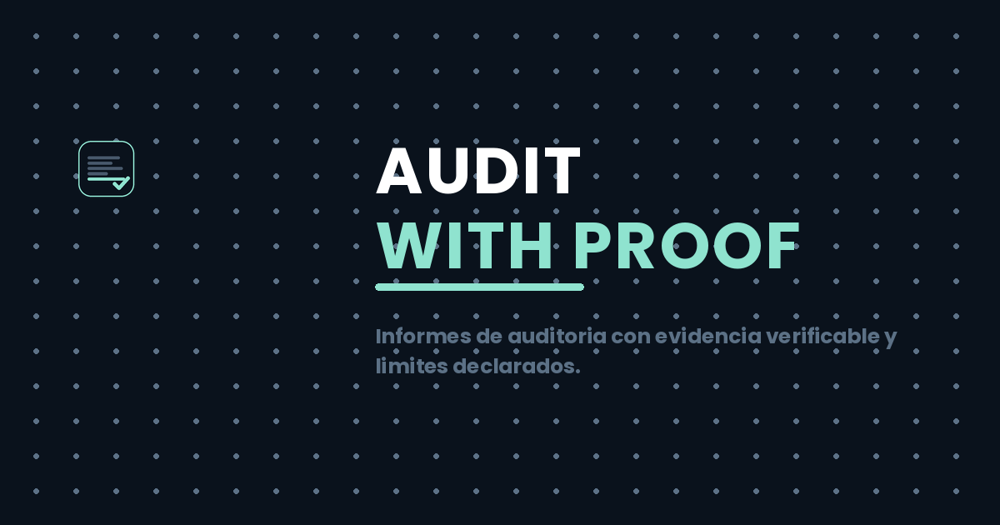

# Electron Security Audit — a real sample, verifiable evidence

<p align="left">
  
</p>

> **Target audited:** draw.io Desktop **v32.4.1** (`drawio-amd64-32.4.1.deb`, 116 MB, GPL-3.0)
> **Public sample** · produced 2026-10-16 with our own engine · **no client involved — this is the demonstration piece**
> **Turnaround:** 48 h standard (this one took a day) · **Evidence chain:** 3 evidence IDs + SHA-256
>
> This is the **exact structure** of what we ship: the report, the template, the authorization,
> the proforma and the evidence bundle — published in full so you can judge it before talking to anyone.
> Every claim below carries a cryptographic evidence ID, and **what we could not determine is declared
> explicitly**. That section is the product.

---

## TL;DR

| | |
|---|---|
| **Overall status** | 🟢 **No critical findings** — secure baseline, with two coverage items to watch |
| **Dependencies (SBOM)** | **82 packages with versions** (9 direct) |
| **CVE cross-check** | **0 of 5 checked CVEs affect this build** (Electron 44.7.0, `electron-updater` 6.8.9) |
| **Electron windows** | 5 `BrowserWindow` → **4/4 verified** (`contextIsolation:true`, `nodeIntegration:false`), **1 dynamic → unverifiable** |
| **IPC surface** | 35 operations · **28 literal channels** · 29 main handlers |
| **`contextBridge`** | only **2 APIs / 6 members exposed** (tight, purpose-scoped) |
| **Secrets in scope** | **0** (5 credential pattern families, zero matches) |
| **Honesty metric** | **92,468 unknowns explicitly declared** + 7 limitations with named files |

---

## Why this repo exists

Desktop apps ship thousands of transitive dependencies nobody inventories. This sample shows what
you get when an Electron/JS build is audited **statically, reproducibly, and honestly**:

1. **Verifiable** — every observation has an `evidence_id`: the SHA-256 of the **canonical semantic
   projection** of the evidence document, recomputable with
   [`evidence/verify-evidence.mjs`](evidence/verify-evidence.mjs) (no dependencies, plain Node). The
   artifact hash is checked against the project's *own* published hash, and you can re-run the whole
   pipeline for free.
2. **Honest** — limitations are a first-class section, not a footnote. Unresolvable things are
   listed as unresolvable. 92,468 unknowns are *counted and indexed*, not swept away.
3. **Legal by construction** — only open-source / self-owned / written-authorized targets.
   Never DRM, anti-cheat, license bypass, or third-party production systems.

---

## Findings at a glance

### 1. SBOM & dependency hygiene

| Finding | Detail | Level |
|---|---|---|
| 82 packages, versions pinned | from every `package.json` manifest inside the `app.asar` | 🟢 |
| 9 direct dependencies | `electron-updater` · `electron-store` · `electron-log` · `@cantoo/pdf-lib` · … | 🟢 |
| **3 duplicated families** | `debug` (2.6.9 **and** 4.4.3) · `ms` (2.0.0 **and** 2.1.3) · `semver` (7.7.4 **and** 7.8.5) | 🟡 |
| Stale transitive line | `debug@2.6.9` (2017-era) still shipped | 🟡 |

### 2. CVE cross-check (NVD / GitHub Advisories / GitLab GLAD / Snyk — queried 2026-10-16)

| CVE | Affects | Installed | Status |
|---|---|---|---|
| CVE-2024-39698 (electron-updater sig bypass) | `< 6.3.0-alpha.6` | **6.8.9** | ✅ not affected |
| CVE-2026-54673 (credential header leak on redirect) | `builder-util-runtime < 9.7.0` | **9.7.0** | ✅ fixed — *sitting exactly on the patch floor* |
| CVE-2026-54672 (AppImage `LD_LIBRARY_PATH`) | build tooling `< 26.15.0` | **26.17.0** | ✅ fixed (build-time) |
| CVE-2026-102672 (Electron, Squirrel.Mac race, macOS) | `≤39.8.x / ≤41.10.4 / <42.0.0-beta.2` | **44.7.0** | ✅ not affected |
| CVE-2026-70604 (Electron CORS on custom schemes) | `≤39.8.9 / ≤40.9.3 / ≤41.4.0 / <42.0.0` | **44.7.0** | ✅ not affected |

> Scope: **5 relevant candidates**, not an exhaustive NVD sweep of all 82 versions — declared in §6.7 of the report.

### 3. Electron security architecture (main process, complete run)

| Vector | Result |
|---|---|
| `contextIsolation` | ✅ `true` in **4/4** windows with literal options |
| `nodeIntegration` | ✅ `false` in **4/4** |
| `webSecurity` / `webviewTag` | ✅ `true` / ✅ `false` in **4/4** |
| `sandbox` | 🟠 explicitly `true` in only **1/5** windows — the rest don't declare it, and we don't assume defaults |
| **1 window (`electron.js:565`)** | 🟠 options built **dynamically → not statically verifiable** |
| `contextBridge` | ✅ tight: `electron{listenOnce, registerMsgListener, request, sendMessage}` + `process{type, versions}` — **no `require`, no `fs`, no raw `ipcRenderer`** |
| IPC | 28 literal channels (file ops, window, updates, config) + 3 dynamic (`action`) · 0 unpaired literal transmissions |
| Sender validation | 🟠 **2 candidates observed among 29 handlers** (`enforcement: unknown`) — *absence of observation ≠ absence of validation* |
| Secrets | ✅ **0** matches across 5 credential pattern families |

---

## How it was audited (and why you can trust it)

```
            ┌────────────── GITHUB ACTIONS (free, public repo) ──────────────┐
 artifact ─▶│ download → SHA-256 vs official Files-SHA256-Hashes.txt ✅      │
 (from the  │ extract .deb → app.asar                                        │
  project's │ REA 6.5.0: analyze-javascript-application (full asar)          │
  release)  │ REA 6.5.0: analyze-javascript-application (main process)       │
            │ Ghidra 12.1.4: binary_overview (ELF x86_64)                    │
            └──────────────┬─────────────────────────────────────────────────┘
                           ▼
              evidence (kilobytes) + evidence IDs + hashes
```

- **The heavy lifting runs in the cloud** (the 116 MB artifact, 543 MB Ghidra) — clients' software
  never touches third-party SaaS; for real engagements the analysis runs on our private runner
  or on yours.
- The whole pipeline is **workflow [`rea-audit.yml`](https://github.com/albrth647-png/Ghidra/actions)** — reproducible at zero cost.

### Runs

| Run | Scope | Result |
|---|---|---|
| [`38856900076`](https://github.com/albrth647-png/Ghidra/actions/runs/38856900076) | full `app.asar` + Ghidra native | ⚠️ partial (honest timeout at 300 s / 1 GB heap on `app.min.js`) + ✅ native complete |
| [`38858685634`](https://github.com/albrth647-png/Ghidra/actions/runs/38858685634) | main process only | ✅ complete in 5 s |

### Evidence chain

| Operation | `evidence_id` |
|---|---|
| JS analysis — full asar | `ev_a94efae81586d359238a5eb1cd34b9a9ed8da7748c3f9a86d4757fe855435ca8` |
| JS analysis — main process | `ev_f0e4202c3b188da10f4be9b3693006b0ba64e3483e7ea100916e388dd413fc2e` |
| Ghidra `binary_overview` — native | `ev_9ec17cfca1a869df4352fd6e5db03285c014f0efc2024a30ec924c337c7a22f0` |

| Artifact | SHA-256 |
|---|---|
| `drawio-amd64-32.4.1.deb` | `f4455b3bba3d3b539c3cd069218fc64f0462b1b01610fe8d11acc3ca8566f32b` ✅ matches official hash |
| `app.asar` (run 1 root) | `e64b9650c0b8241ca9a7d33b56386a385bceee63270cec701d3a467347b697e6` |
| `src/main` dir (run 2 root) | `04b32cf796534f828ddb3b57568be1e7e1be27f9f8d43debc924af49b5d19596` |

**Reproduce it yourself:**

```bash
curl -LO https://github.com/jgraph/drawio-desktop/releases/download/v32.4.1/drawio-amd64-32.4.1.deb
sha256sum drawio-amd64-32.4.1.deb    # → f4455b3b…
rea analyze-javascript-application <target> --json
```

Raw evidence bundle: [`evidence/`](evidence/) · summary index: [`evidence/evidence-summary.json`](evidence/evidence-summary.json)

---

## What we deliberately do NOT claim

Most due-diligence reports hide their blind spots. We publish them:

1. Source analysis was **interrupted** by explicit limits (300 s, 1 GB heap) on the huge minified
   bundle `app.min.js` — the run stopped, and that's recorded, not hidden.
2. Inline JavaScript in `dropbox.html`, `github.html`, `gitlab.html` was **not analyzed** (named in §6.1).
3. **92,468 unknowns** are indexed with IDs across 12 fact families — all `partial`.
4. Static analysis: **nothing was executed**; runtime behavior, defaults, and enforcement remain unproven.
5. CSP and the renderer HTML live outside this scope — *not evidenced ≠ not present*.
6. Only the **`.deb`** artifact was audited (AppImage/Windows/macOS builds may differ).
7. The Electron version (44.7.0) comes from the tag's lockfile — not read from the binary itself.

Full section: [docs/audit-report-drawio-32.4.1.md](docs/audit-report-drawio-32.4.1.md) §6.

---

## The service — what you get

> **Entry package: flat 150 USDT** (TRC-20) · delivered in **48 h** ·
> your artifact never touches third-party SaaS: the analysis runs on our private runner or yours.
> (This public sample ran in a *public* CI runner — the target is public software.)

| # | Deliverable |
|---|---|
| 1 | **SBOM** — full dependency tree with versions |
| 2 | **Risk** — vulnerable / stale dependencies, CVE cross-check |
| 3 | **Exposure** — Electron vectors: `contextIsolation`, `nodeIntegration`, `sandbox`, CSP, IPC channels |
| 4 | **Secrets** — embedded credentials in the bundle (presence only, never extracted) |
| 5 | **Limits & unknowns** — the honest section (see above) |
| 6 | **Evidence IDs** — third-party verifiable proof for every claim |

**Not included** (available in higher tiers): remediation · source review · dynamic analysis ·
native binary deep-dive (Ghidra) · infrastructure audit · SLA.

| Package | Price | Scope |
|---|---|---|
| Entry | **150 USDT** | everything above, 48 h |
| Standard | 600 USDT | + prioritized remediation, 5 days |
| Pro | 2,500 USDT | + deep audit + guided remediation, 2 weeks |
| Enterprise | 5,000–15,000 USDT | + native analysis (Ghidra) + ongoing support |

### How to start

```
① You send the artifact + sign the authorization form   → docs/engagement-authorization.md
② You pay 150 USDT (TRC-20) — proforma: docs/payment-proforma.md
③ We deliver the report ≤ 48 h + evidence IDs          → docs/audit-report-drawio-32.4.1.md (format of what you receive)
```

**Contact:** open an issue on this repo (add a `[private]` prefix if you prefer — we'll reply with
a private channel), or use the contact listed on my GitHub profile.

---

## Documents

| Document | ES |
|---|---|
| [Full audit report (draw.io 32.4.1)](docs/audit-report-drawio-32.4.1.md) | [es/informe-muestra.md](docs/es/informe-muestra.md) |
| [Report template (what a deliverable contains)](docs/report-template.md) | [es/plantilla-informe.md](docs/es/plantilla-informe.md) |
| [Engagement & confidentiality authorization](docs/engagement-authorization.md) | [es/autorizacion.md](docs/es/autorizacion.md) |
| [Payment proforma (150 USDT, TRC-20)](docs/payment-proforma.md) | [es/proforma.md](docs/es/proforma.md) |

---

## Scope & legal

- [Privacy](privacy.html) · [Terms](terms.html)

- Targets are **open-source (public license), self-owned, or covered by written authorization + NDA** only.
- **Never:** DRM/license circumvention · anti-cheat bypass · authentication bypass · attacks against
  third-party production systems · cloning proprietary software. Analysis is **read-only, static**.
- See the [REA disclaimer](https://github.com/rea-agent/rea/blob/main/DISCLAIMER.md).
- This report is a **sample** on open-source software (draw.io, GPL-3.0); client reports are private.

---

*Pipeline: [REA](https://github.com/rea-agent/rea) 6.5.0 + Ghidra 12.1.4 on free GitHub Actions.*
*Report © 2026 — free to share and link with attribution. No warranty; see report §6 (limits).*
